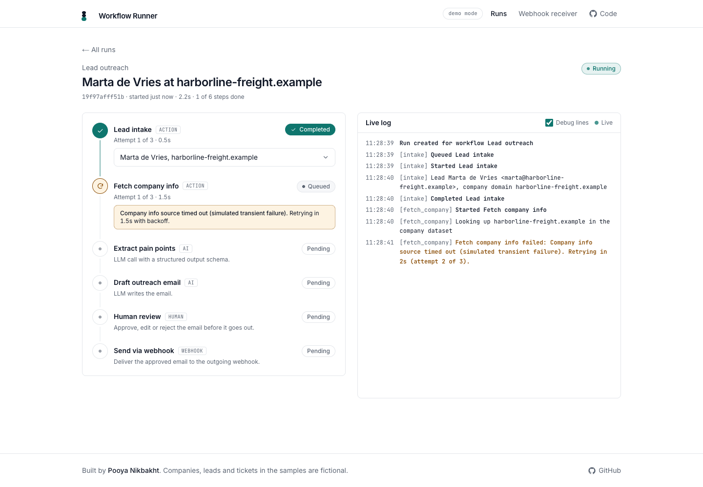
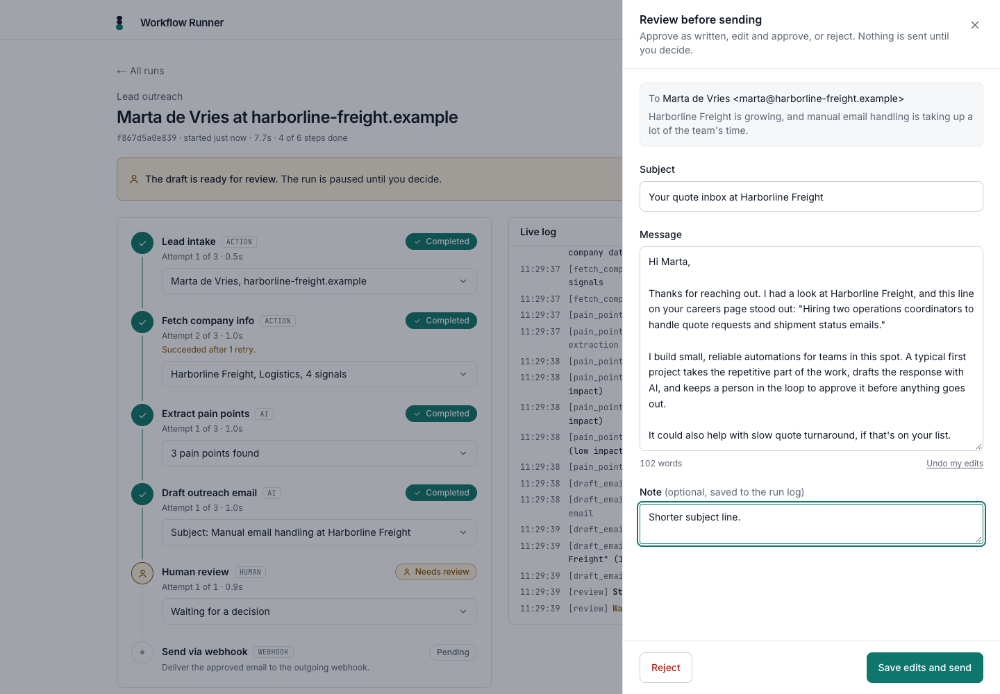
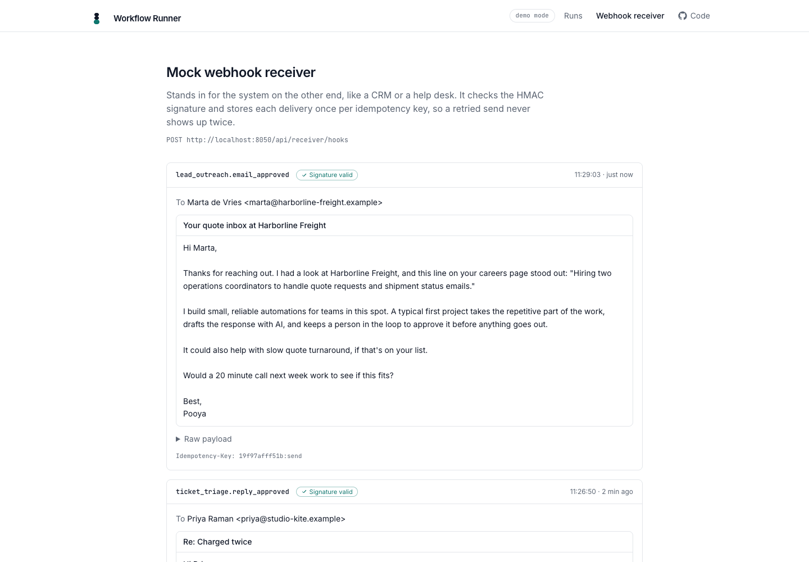
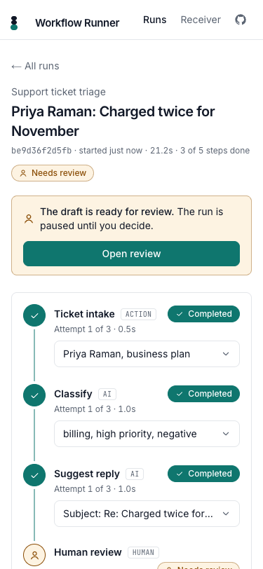
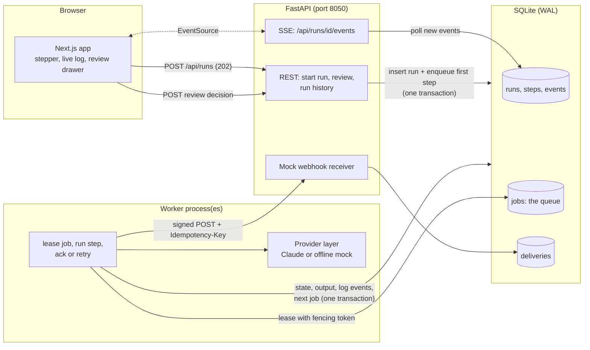

# Workflow Runner

**Multi-step AI workflows you can watch and approve.** Start a workflow, watch each step run live, and step in at the review step to approve, edit or reject what the AI wrote before anything leaves the system.

It's for startups and technical teams who want AI automations that behave like the rest of their backend: work runs on a queue in a separate worker process, flaky steps retry with backoff, every step is safe to run twice, every run is stored, and a person signs off on anything that gets sent. The seeded example is lead outreach: lead intake, company lookup, pain point extraction, an outreach email draft, human review and a webhook delivery. A second workflow, support ticket triage, runs on the same engine.

A portfolio project by Pooya Nikbakht, a senior full-stack engineer. FastAPI, a queue worker and Next.js, with Claude behind a small provider interface and a demo mode that needs no API key. Every company, lead and ticket in the samples is fictional.



| Review drawer: edit, approve or reject | Webhook receiver: signed, deduplicated deliveries |
|---|---|
|  |  |



## What it does

1. **Start a run.** Pick a workflow, load a sample (or type your own lead or ticket) and press Start. The API saves the run, queues the first step and answers `202` straight away.
2. **Watch it work.** A worker process leases the job and runs the step. The stepper and the log update live over Server-Sent Events: started, retrying, validated, completed.
3. **See a retry.** The company lookup fails once on purpose ("simulated transient failure"). The step goes back to the queue, the UI counts down the backoff, and attempt 2 succeeds.
4. **Review.** The run pauses at the review step. Open the drawer to approve the draft as written, edit it and approve, or reject it with a note.
5. **Send.** Approval queues the send step, which posts a signed webhook with an idempotency key to a mock receiver page that shows the payload.

### The two workflows

| Lead outreach | Support ticket triage |
|---|---|
| Lead intake | Ticket intake |
| Fetch company info (local fixture dataset, fails once to show a retry) | Classify: category, priority, sentiment (AI) |
| Extract pain points (AI, structured output) | Suggest reply (AI, structured output) |
| Draft outreach email (AI, structured output) | Human review |
| Human review | Send via webhook |
| Send via webhook | |

A workflow is an input model plus a list of step definitions (`backend/app/workflows.py`). The engine, queue, worker, review step and webhook step don't know which workflow they're running.

## Architecture



- **API** (`app/main.py`): validates input, writes the run and queues the first job, records review decisions, streams events. It never executes a step.
- **Worker** (`app/worker.py`): a loop that leases one job, runs it through the engine and goes back for more. Run as many as you like.
- **Engine** (`app/engine.py`): the state machine. Each step change, its log line, the job ack and the next job are written in a single transaction.
- **Queue** (`app/queue.py`): a `Queue` protocol with five methods and a SQLite implementation.
- **Providers** (`app/providers/`): Claude through the official `anthropic` SDK, and a deterministic offline mock.

## Key decisions

**Why a queue and a separate worker.** LLM calls take seconds, fail in ways worth retrying, and sometimes wait on a person for hours. Running them inside an HTTP request ties up the server, loses work on a restart and makes retries awkward. Here the request only writes intent; the worker owns execution. A crash mid-step loses nothing: the job's lease expires and another worker picks it up.

**Why SQLite for the queue.** Redis isn't installed on this machine and the goal was `make dev` with no extra services. SQLite in WAL mode handles this well for a single host: `BEGIN IMMEDIATE` plus `UPDATE ... RETURNING` leases a job atomically, so two workers never get the same one (there's a test with two connections leasing 60 jobs in parallel threads). A bonus over a separate broker: the job ack, the step's state change and the next enqueue commit together, so there's no window where a step is done but its successor was never queued.

**Leases and fencing.** A leased job carries a random token. Completing, retrying or burying a job checks the token, so a worker that stalled past its lease can't overwrite the result of the worker that took over. The step state machine allows `running -> running` for exactly that takeover.

**Idempotency, at three levels.**
- Enqueue: each job has a unique key (`run_id:step`). A double click on Approve can't queue the send twice.
- Execution: a redelivered job for a step that's already completed, skipped or waiting for review is acknowledged without running.
- Side effects: the webhook carries `Idempotency-Key: run_id:send`. If the send is retried after the receiver already got it, the receiver records the repeat and keeps one copy.

**Retries.** Handlers raise `TransientError` (timeouts, 5xx, 429, model output that broke the schema) or `PermanentError` (unknown company, rejected request, refusal). Transient errors go back on the queue with exponential backoff (`2s, 4s, 8s...`, capped) until the step's `max_attempts`; then the run fails and the job is marked dead. The SDK's own retries are turned off so every retry is visible in the log.

**Why Server-Sent Events.** Updates only flow one way, from server to browser, and SSE does that over plain HTTP with automatic reconnects. Every log event has an id, so a reconnecting browser sends `Last-Event-ID` and gets exactly what it missed. The worker is another process, so the SSE handler polls the events table every 300 ms; with Postgres you'd use `LISTEN/NOTIFY`, with Redis a pub/sub channel. WebSockets would add a protocol and a connection manager for no benefit here.

**How human review works.** A review step is a step with no handler. When the worker reaches it, it stores the draft as a proposal, sets the step to `needs_review`, pauses the run and acks the job, so no worker is held while a person thinks. `POST /api/runs/{id}/review` takes `approve`, `edit` (with the new subject and body) or `reject` (with an optional note). Approve and edit store the final text and queue the next step; reject skips the rest and marks the run rejected. A second decision gets a `409`.

**Structured AI output.** Each AI step names a pydantic model. The Claude adapter calls `messages.parse` with that model as the output format, so the API constrains the answer to its JSON schema and the SDK hands back a validated object. Effort is set through `output_config.effort`, the server-side refusal fallback is on for Opus, and no sampling or thinking parameters are sent. The offline mock builds answers from the same context with simple rules and validates them through the same models.

### Swapping in Redis or SQS

Write a class with the five `Queue` methods (`enqueue`, `lease`, `complete`, `retry`, `bury`) and pass it to the engine.

- **Redis:** a sorted set keyed by `run_at` for ready and delayed jobs, `ZPOPMIN` or a Lua script to lease into a processing set with a deadline, and a reaper that moves expired leases back. Or use Redis Streams with consumer groups, `XAUTOCLAIM` for expired work and `XACK` to complete. Use `SET NX` on the idempotency key for dedup.
- **SQS:** `SendMessage` with `DelaySeconds` for backoff, the visibility timeout as the lease, the receipt handle as the fencing token, `DeleteMessage` to complete, and a dead-letter queue after `maxReceiveCount`. FIFO queues add deduplication ids.
- **What changes:** the queue no longer shares a transaction with the database. Write next-step jobs to an outbox table in the same transaction as the state change and have a small relay publish them. Delivery stays at-least-once, which the engine already handles because steps are idempotent.

### What I'd do next in production

Postgres instead of SQLite (`SELECT ... FOR UPDATE SKIP LOCKED` for the queue, `LISTEN/NOTIFY` for the event stream), auth and per-team workflows, a heartbeat that extends leases for long steps, run cancellation and manual re-run of a failed step, metrics on queue depth and step latency, and an eval set for the prompts.

## Run it locally

Needs [uv](https://docs.astral.sh/uv/) (Python 3.12) and Node 22.

```bash
make install   # uv sync + npm ci
make dev       # API on :8050, one worker, app on :3050
```

Open http://localhost:3050. With no API key the app runs in demo mode: a deterministic offline model answers the AI steps, and a small badge in the header says so. To use Claude, copy `backend/.env.example` to `backend/.env` and set `ANTHROPIC_API_KEY`.

Want to see workers share the queue? Run `make worker` in a couple more terminals and start a few runs.

```bash
make test      # pytest
make lint      # ruff, eslint, tsc
make check     # lint + tests + production build
```

### Environment variables

Backend (`backend/.env`):

| Variable | Default | What it does |
|---|---|---|
| `LLM_PROVIDER` | empty | `anthropic` or `offline`. Empty uses Anthropic when a key is set, else offline. |
| `ANTHROPIC_API_KEY` | empty | Claude API key. Read on the server only. |
| `ANTHROPIC_MODEL` | `claude-opus-5-5` | A public demo would set `claude-haiku-5-5`. |
| `ANTHROPIC_EFFORT` | `medium` | `low` to `max`, sent as `output_config.effort`. |
| `DATA_DIR` | `./data` | Where the SQLite file lives. |
| `CORS_ORIGINS` | `http://localhost:3050` | Allowed frontend origins. |
| `LEASE_SECONDS` | `30` | How long a worker owns a job before another may take it. |
| `RETRY_BASE_SECONDS` / `RETRY_MAX_SECONDS` | `2` / `60` | Exponential backoff base and cap. |
| `WEBHOOK_URL` | the built-in mock receiver | Where the send step posts. |
| `WEBHOOK_SECRET` | `local-dev-secret` | HMAC-SHA256 key for the `X-Runner-Signature` header. |
| `STEP_DELAY_SECONDS` | `1.0` | Demo pacing so runs are easy to follow. `0` runs at full speed. |

Frontend (`frontend/.env.local`):

| Variable | Default | What it does |
|---|---|---|
| `NEXT_PUBLIC_API_URL` | `http://localhost:8050` | The FastAPI backend. |

## Tests

`backend/tests` covers queue leasing, ordering, delays, lease takeover and fencing, transactional enqueue and two concurrent workers; the step and run state machines; the workflow definitions and samples; full runs of both workflows through the engine (retry, review, edit, reject, permanent failure, retries running out, redelivered jobs, a crashed worker); the API including the SSE stream and `Last-Event-ID` resume; the receiver's signature check and dedup; and the Claude adapter against the real SDK with an in-memory HTTP transport (request shape, structured output parsing, error mapping, refusals, schema failures).

## Deploy notes

Nothing is deployed from this repo. The API and the worker are two long-running processes that share a database, so the natural fit is a small VM or a container platform that runs both (Fly.io, Render, Railway, or Cloud Run with an always-on worker), with Postgres replacing SQLite once there is more than one host. The frontend is a standard Next.js app.
